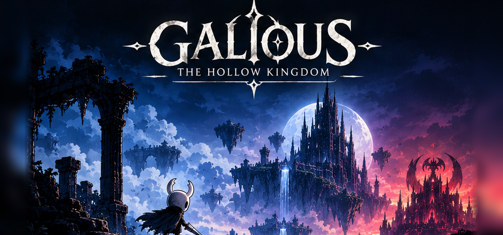

<p align="center">
  
</p>

# Galious: The Hollow Kingdom

Un remake en **Unity** de *Knightmare II: The Maze of Galious* (Konami, MSX, 1987) vestido con el arte, la música y la
sensación de **Hollow Knight** (Team Cherry, 2017). Es un **proyecto educativo**: aprender cómo está hecho un juego por
dentro, ingeniería inversa incluida, y rehacerlo en un motor moderno.

- **Fiel al original:** las mecánicas se reimplementan a partir de la documentación de la ROM (`docs/`), no traduciendo el
  código ensamblador: física del salto, enemigos, jefes, santuarios, objetos, mapas y salas son los del juego de 1987.
- **Mejorado donde hace falta:** cada cambio es una regla del remake (`RemakeRules.cs`) documentada en el capítulo 11 de
  la biblia de diseño: bancos y sombra al morir, mapas de Cornifer, amuletos, tajos arriba y abajo, nadar, el ambiente
  de cada zona…
- **Con el arte de Hollow Knight:** el Caballero, los enemigos y jefes, el escenario, la música y la interfaz.

📖 **Wiki de cómo se hizo:** la web de `wiki/` (GitHub Pages): arquitectura, Unity, texturas, ambiente, efectos, música,
rendimiento, builds, enemigos, jefes y mundos.

> ⚠️ Repositorio **privado**. Contiene la ROM del juego original (propiedad de Konami) y arte y música de Hollow Knight
> (propiedad de Team Cherry), solo para uso personal y educativo. No se distribuye.

## Jugar

Las builds salen del CI en la Release **Última build** del repo (Actions → *Builds* → *Run workflow*):

| Plataforma | Paquete | Cómo |
|---|---|---|
| **Windows** | `Galious-Windows.zip` | Descomprimir y abrir `Galious.exe` (SmartScreen: *Más información* → *Ejecutar de todas formas*). |
| **Linux / SteamOS** | `Galious-Linux.tar.gz` | `tar -xzf Galious-Linux.tar.gz` y abrir `Galious.x86_64`. En SteamOS (Steam Deck, Legion Go): modo escritorio → Steam → *Añadir un juego que no es de Steam* → `Galious.x86_64`. Las imágenes para la biblioteca están en `steam/` (Propiedades → Personalizar). |
| **macOS** | `Galious-macOS.tar.gz` | Descomprimir y abrir `Galious.app` (la primera vez, clic derecho → *Abrir*: no está firmada). |
| **Web** | `Galious-Web.zip` | Servir la carpeta con un servidor web (`python3 -m http.server`) y abrir `index.html`. |

**Controles** (se cambian en *Opciones → Mando / Teclado*):

| Acción | Mando | Teclado |
|---|---|---|
| Moverse, apuntar arriba / abajo | stick izquierdo o cruceta | flechas |
| Saltar | A | Z |
| Atacar (con ↑, hacia arriba; con ↓ en el aire, hacia abajo) | X | Espacio |
| Concentrarse (curarse) | B | F |
| Arma secundaria | Y | M |
| Biblia | LB | Ctrl izquierdo |
| Escribir la palabra del jefe | RB | el teclado |
| Inventario | Select | I |
| Pausa | Start | Esc |

## Compilar y modificar

Es de código abierto para quien tenga acceso: se puede cambiar todo.

1. **Unity 6000.6.5f1** (Unity Hub) con los módulos *Mac*, *Windows Build Support (Mono)*, *Linux Build Support (Mono)*
   y *WebGL*.
2. Abrir `unity/MazeOfKnight`. Todo lo importado ya está en el repo (`Assets/Generated` desde la ROM y
   `Assets/Art/Resources/Hollow` desde Hollow Knight); para regenerarlo, `tools/` (ver `docs/unity.md`).
3. Escena `Assets/Scenes/Game.unity` → Play. El menú **Maze of Knight** compila para cada plataforma
   (`Builds/Galious.app`, `Builds/Linux`, `Builds/Windows`, `Builds/Web`).
4. Pruebas: *Window → General → Test Runner → EditMode* (o `-runTests -testPlatform EditMode`).

En línea de comandos (macOS):

```bash
/Applications/Unity/Hub/Editor/6000.6.5f1/Unity.app/Contents/MacOS/Unity -batchmode -quit -projectPath unity/MazeOfKnight -executeMethod MazeOfKnight.EditorTools.GameBuild.BuildMac
```

Cada regla del remake se puede apagar en `Assets/Scripts/Runtime/Game/RemakeRules.cs` para jugar como el original.

### CI

- **Pruebas** (`.github/workflows/tests.yml`): en cada push, con [GameCI](https://game.ci).
- **Builds** (`.github/workflows/builds.yml`): a mano o con una etiqueta `v*`; Windows, Linux, macOS y web en servidores
  Linux, subidas a la Release.
- **Wiki** (`.github/workflows/wiki.yml`): publica `wiki/` en GitHub Pages.

Necesitan tres secretos del repo (*Settings → Secrets and variables → Actions*): `UNITY_LICENSE` (el contenido de
`Unity_lic.ulf`), `UNITY_EMAIL` y `UNITY_PASSWORD`.

## Estructura

| Carpeta | Qué hay |
|---|---|
| `unity/MazeOfKnight` | El proyecto de Unity: `Assets/Scripts/Runtime` (el juego), `Assets/Scripts/Editor` (importadores y builds), `Assets/Tests` |
| `docs/` | Ingeniería inversa del original (física, enemigos, jefes, mapas, música) y la biblia de diseño del remake |
| `tools/` | Extracción de la ROM (Python), importadores del arte de Hollow Knight (`tools/hollow`) |
| `rom/`, `extracted/` | La ROM y lo extraído de ella |
| `assets/` | Portadas, cubierta, icono y arte para Steam |
| `wiki/` | La web de cómo se hizo |

## Créditos

- *Knightmare II: The Maze of Galious* © Konami 1987.
- *Hollow Knight* © Team Cherry 2017: arte, música y personajes.
- Remake, herramientas y documentación: [rldona](https://github.com/rldona).
